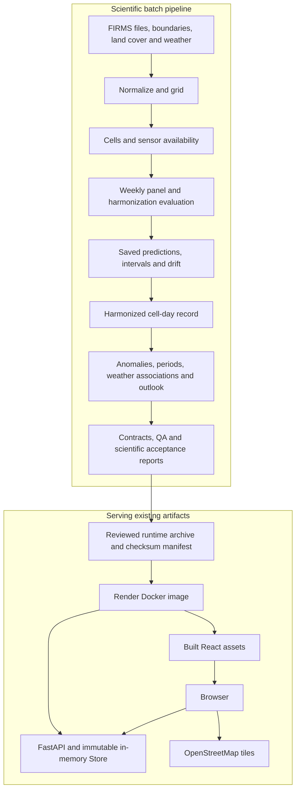

# FireSense architecture

Reviewed 6 November 2026 against source revision `e97d49f`. This describes implemented code, not every feature on the plan. Read the [scientific walkthrough](../science/harmonization-walkthrough.md) for the meaning of the numbers and the [dated assessment](review-2026-11-06.md) for evidence, limitations and the hackathon rating.

## 1. What the system is

FireSense is a regional historical fire-activity explorer. It expresses NASA FIRMS detections in Suomi NPP VIIRS-equivalent terms and provides a calendar, map, time series, unusual periods, season profiles, weather associations and CSV exports.

The current catalog contains eight Bangladesh divisions and Punjab, Haryana and Delhi. The API also accepts polygons and bounding boxes, but selects only cells already present in its regional artifacts. Sending a polygon somewhere else does not acquire or harmonize data for that place.

It is a Python scientific batch application plus a Python API and a React browser client. There is no database server, distributed training system or separate model-inference service. The public API reads prepared results; it does not train on requests.

## 2. Two execution paths

The boundary matters: a successful code build does not update satellite data, refit ratios or validate revised science. A new data release and a new code release are separate operations.

## 3. Source map

| Location | Responsibility | Useful entry points |
|---|---|---|
| `common/` | Shared grid, time, source, aggregation, interval, split and metric conventions | `grid.py`, `series.py`, `climatology.py`, `intervals.py`, `splits.py` |
| `ws3_anomaly/ingest/` | FIRMS acquisition and normalization | `firms.py`, `normalize.py` |
| `ws2_platform/` | Administrative cells, gridding and operating-day/outage handling | `cells.py`, `grid.py`, `sensors.py`, `coverage.py` |
| `ws1_harmonize/` | Weekly panel, ratio baselines, learned candidates and holdout selection | `panel.py`, `baselines.py`, `features.py`, `evaluate.py`, `write_harmonized.py` |
| `ws3_anomaly/` | Unusual weeks, ranked periods and weather associations | `anomaly.py`, `periods.py`, `drivers.py`, `batch.py` |
| `ws4_outlook/` | Uncertainty diagnostics, drift, seasonal summaries and forecast evaluation | `conformal.py`, `interval_report.py`, `season_profile.py`, `outlook.py` |
| `ws2_platform/api/` | Runtime data access, request validation, JSON/CSV responses and static asset hosting | `query.py`, `app.py`, `frontend.py` |
| `ws5_frontend/src/` | Named-area selection, presentation, request lifecycle and translations | `App.tsx`, `api.ts`, `areas.ts`, `components/` |
| `contracts/` | OpenAPI, JSON schemas, Parquet schemas and example requests/responses | `openapi.yaml`, `parquet_schemas.json` |
| `ws6_validation/` | Data, contract, integration and scientific-acceptance checks | `qa.py`, `tests/` |
| `scripts/` | Human workflows, runtime packaging/release and read-only serving diagnostics | `run_pipeline.py`, `runtime_bundle.py`, `release_runtime.py` |

The `ws` names are workstream boundaries, not independent microservices. They import one another inside one repository.

## 4. Data ownership and contracts

| Artifact | Producer | Consumers / meaning |
|---|---|---|
| `detections.parquet` | FIRMS normalizer | UTC acquisition-level records; not the harmonized calendar |
| `grid_daily.parquet` | Gridding | Sparse `(cell_id, local solar date, satellite)` detection aggregates |
| `cells.parquet` | Cell/boundary builder | Cell centers, administrative assignment and land-cover attributes |
| `sensor_days.parquet` | Availability builder | `(date, satellite)` operating flags and explanations |
| `coverage_days.parquet` | Outage overlap analysis | Diagnostic overlap by region, satellite and day |
| `predictions_oof.parquet` | Held-out harmonization evaluation | Calibration/test predictions and split labels; not runtime forecasting |
| `harmonized.parquet` | Harmonized writer | Sparse cell-day values with source and method provenance |
| `interval_table.json` | Human-operated interval calibration | Aggregate interval lookup coefficients |
| `drivers_region.json` | Weather association batch | Administrative-region context, not a fresh analysis for each polygon |
| `outlook_region.json` | Outlook batch | Saved regional skill/alert disposition |
| `validation/*.json` | Each scientific producer / QA | Evidence pieces assembled by the API |
| `public/demo/areas.json` | Catalog exporter | Geometry and IDs for the supported areas; the directory name survives snapshot retirement |

Raw downloads, models, credentials and run directories stay outside Git. The serving archive includes only the runtime allowlist, not raw detections or trained learner files. See [runtime packaging](../../scripts/runtime_bundle.py) for the exact current membership.

## 5. A browser request, end to end

1. `App.tsx` loads the area catalog and `/health` record-end metadata. It uses a labelled fallback date if metadata fails.
2. The map retains the original geometry. For a catalog area, `analysisArea()` sends a compact `area_id` instead of retransmitting its polygon.
3. The API accepts exactly one of `area_id`, `geometry` or `bbox`, plus dates and a day/week/month resolution.
4. `Store.select()` resolves IDs to the same center-selected cell membership as the original polygon. Spatial queries use a Shapely `STRtree`.
5. `/aoi/summary` sums saved cell-day values and constructs interval/anomaly metadata. The browser then requests periods, drivers, outlook and season products.
6. Selecting a calendar week or critical period requests `/aoi/cells` for the corresponding map layer. Comparison uses `/aoi/compare`; exports use `/export`.

Date-only changes are debounced. Obsolete batches and comparisons use `AbortController`, and generation checks prevent late responses from replacing newer selections. Browser cancellation prevents stale presentation; it does not guarantee already-running server work is cancelled.

## 6. Endpoint semantics

| Endpoint | Computation / scope |
|---|---|
| `GET /health` | Loaded method version, available cells and record end |
| `GET /version.json` | Deployed Git revision from the hosting environment |
| `POST /aoi/summary` | AOI series for requested dates/resolution; weekly anomaly flags |
| `POST /aoi/cells` | Positive cell totals for the requested period |
| `POST /aoi/critical-periods` | Full-history AOI scoring, filtered to periods intersecting requested dates |
| `POST /aoi/drivers` | Saved analysis for the administrative region containing most selected cells |
| `POST /aoi/outlook` | AOI historical status/season position; saved main-region skill and alert state |
| `POST /aoi/season` | Configured seasons over full AOI history, independent of requested display dates |
| `POST /aoi/compare` | Two summaries using a common date span and resolution |
| `GET /meta/validation` | Evidence pieces plus missing/corrupt-file notices |
| `POST /export` | CSV for summary, cells or critical periods |

`data_through` in a season profile can mean the complete-week cutoff. `record_data_through` identifies the entire served record. Neither means that the API fetched observations today.

## 7. Store and caching

The lazily initialized Store is guarded by a lock. It reads the needed harmonized columns, categorical source labels, cell attributes, availability calendar and saved regional products into memory.

Request cache identity combines artifact revision, canonical selected-cell membership and only the fields relevant to the endpoint. Equivalent polygons/IDs can share results. The response LRU is bounded at 256 entries and shares same-key in-flight work through futures. A separate Store memo holds up to 64 cell-set products such as full histories and scored series.

These are entry limits, not memory-byte limits. They do not establish safe concurrent capacity on Render. Store artifacts are treated as immutable for the process lifetime; replacing files in place is not a supported refresh mechanism. Publish a new runtime and restart/redeploy instead.

## 8. Deployment and trust boundaries

The root [Dockerfile](../../Dockerfile) has a Node frontend stage and a minimal Python serving stage. The frontend stage runs tests, string lint and compilation. The Python stage downloads the manifest-pinned runtime, validates its checksum/layout and saved validation markers, then starts one Uvicorn worker serving UI and API from one origin.

- FIRMS credentials belong in server-side acquisition workflows, never browser variables or map URLs.
- OpenStreetMap supplies map tiles; administrative boundaries come from the catalog's documented sources.
- Archive extraction uses an exact allowlist and size/path checks. Legacy supported archive layouts remain explicit.
- `release_runtime.py` verifies the selected archive's record-end date, creates a new release and verifies the downloaded asset before writing the manifest.
- The repository currently has no general CI test workflow. `pr-guard.yml` checks ownership; Render's image build checks the frontend. Python/scientific checks must be recorded separately.
- GitHub Pages, snapshot mode, static response fallback and Bangla delivery are retired. The English interface still uses i18next for centralized text.

The blueprint expresses intended deployment settings. Only a live revision check and the host's actual logs/settings can establish what was deployed or why a deployment failed.

## 9. How to inspect it safely

Start with contracts, `common/series.py`, `query.py`, `app.py` and `App.tsx`; then read the method and evaluation code. Use the reviewed tiny API fixtures for routine request tests. Read [AGENTS.md](../../AGENTS.md) before scientific execution: agent-operated training, probes, full Python suites and pipeline stages are now authorized with run specifications and preserved baselines.

For a change, identify its layer first. UI wording can be checked without fits. A change to features, targets, calibration or scientific acceptance cannot be validated by frontend/unit passes alone. Record the source revision, artifact provenance and required numerical/user validation separately.
