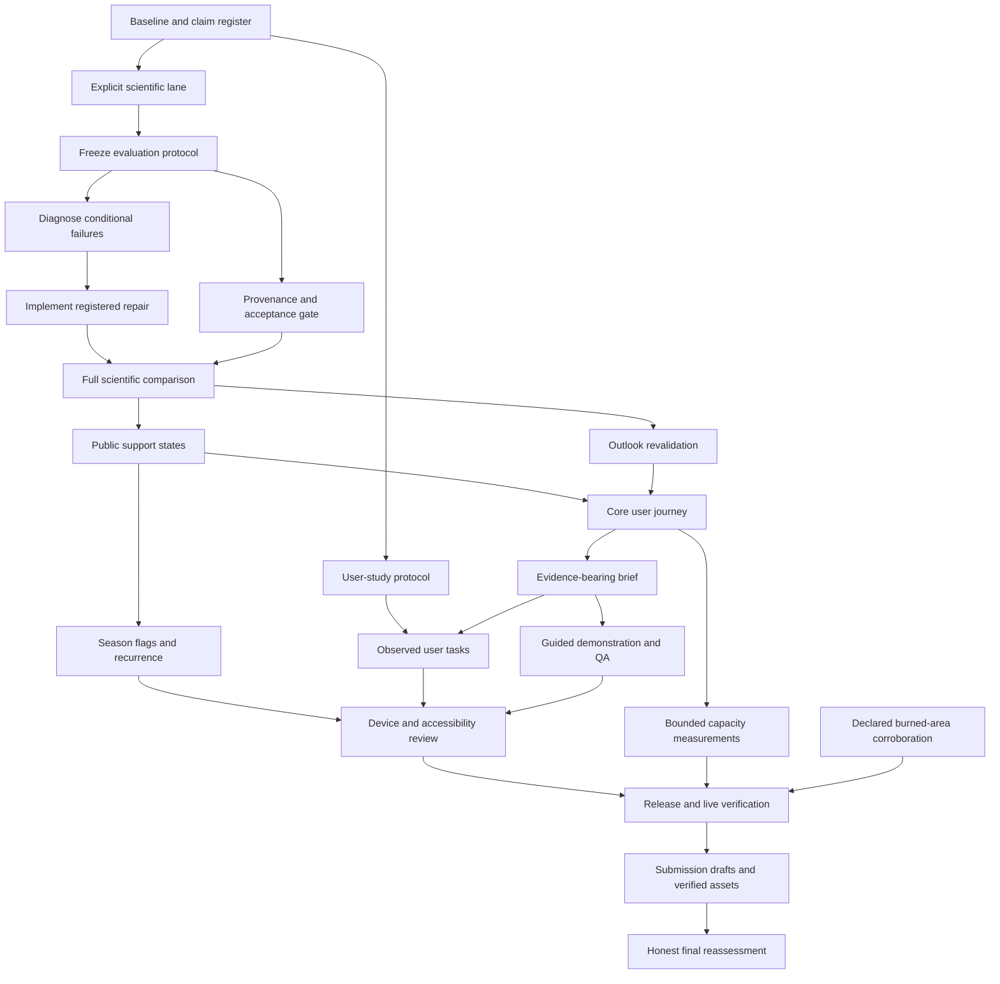

# Executable hardening scaffold

Installed as a planning change on 6 November 2026 against source `e97d49f`. The [challenge contract](../plan/CHALLENGE_CONTRACT.md), [cards](../plan/tasks/), [status board](../plan/STATUS.md), [I13 science protocol](../specs/I13_SCIENTIFIC_ACCEPTANCE.md) and [run specifications](../plan/runs/) form the execution scaffold. The earlier [roadmap](roadmap-to-nine.md) explains the rationale; these cards define current order and file scope.

No implementation, training or completed scientific gate is implied by installing a card. Sheikh has authorized agent-operated scientific execution; [AGENTS.md](../../AGENTS.md) governs preservation, evidence and the unchanged Git flow.

The scheduler reads the **committed** board. Until Sheikh commits this scaffold, `plan.py next` can correctly report that no agent card can start: the old board does not yet contain T51. The working-tree dependency projection starts at T51; do not change the scheduler or falsely mark cards done to avoid that handover.

## 1. Submission being built

A regional historical burning-activity explorer that makes MODIS/VIIRS records comparable on an explicit reference scale, lets users select an area, explore temporal patterns/unusual periods, compare recent and historical activity, and export a useful brief. It keeps observations, adjustments, reconstruction, availability and uncertainty limits visible.

The [challenge proposer's announcement](https://www.argentina.gob.ar/noticias/desafio-nasa-space-apps-challenge-2026-crea-soluciones-para-monitorear-incendios-con-datos) supports this core direction. Full official resources/submission limits remain unverified where retrieval failed. C01-C06 in the contract are challenge-facing outcomes; Q01-Q05 are internal quality controls. No judge weights, forecast mandate or award probability is invented.

## 2. Execution graph

The table/actual card `needs` fields are authoritative; this diagram omits some already-completed dependencies for readability. Optional cuts count as dependency completion only when their actual omission and score deduction are recorded.

## 3. Work packages and exit evidence

| Order | Cards | Deliverable | Exit evidence |
|---|---|---|---|
| 1 | T51 | Protected baseline and claim register | Actual source/artifact identity; unresolved failures preserved |
| Early support | T61 | Neutral formative study protocol | Ready for Sheikh's recruitment; no invented participants |
| 2 | T52 | Scientific command lane | Mocked proof default checks cannot fit; explicit lane preserves outputs |
| 3 | T53 | Locked evaluation protocol | Actual splits/targets/support, prior test exposure and registered criteria |
| 4 | T54 | Conditional interval diagnosis | Cause hypotheses with examples; calendar alignment and AOI applicability |
| 5 | T55 | Bounded candidate implementation | Pure regression checks; reproducible configuration; no test-set tuning |
| Parallel design | T57 | Provenance and scoped acceptance | Fabricated green QA cannot accept incompatible/failing science |
| 6 | T56 / S01 | Full numerical comparison | Every required holdout/combo, support/coverage/width/score and all trial dispositions |
| 7 | T58, T59 / S02 | Public limits and corrected outlook | API/UI/exports agree; unsupported forecast alerts remain off |
| 8 | T60 | Core geographic/calendar/comparison/export journey | Actual browser behavior and focused regression evidence |
| 9 | T14, T15, T21 | Qualified season flags and observed recurrence | Correct reference/denominator/provenance; no calibrated-season pretense |
| 10 | T22, H06 | Printable brief and observed use | Readable artifact; anonymized intended-user task outcomes |
| Corroboration | T33, T24 | Declared burned-area sample/check | QA/geometry verified; shared-input limits and weak results disclosed |
| 11 | T23, T27, T34, T62 | Demonstration, QA, accessible interaction and capacity | Actual timings/devices/errors/payload/resource observations |
| 12 | T28 / S03 | Immutable release dossier | Intended code/runtime/evidence verified live; rollback/contingency |
| 13 | T29, T35, T63 | Attributed assets and reassessment | Verified format limits, truthful claims and evidence-backed final score |

T17/T49 remain historical closeout reviews. Their old stale deployment notes are replaced with references to dated observations, not a new unexecuted live claim. T13 remains reporting review; scientific acceptance is owned by T54-T58, not inferred from report presence.

## 4. Scientific execution contract

Read I13 plus [S01](../plan/runs/S01_harmonization.md), [S02](../plan/runs/S02_outlook.md) and [S03](../plan/runs/S03_release-validation.md). The first scientific run happens only after its prerequisite implementation/protocol cards. Planning does not execute a fit.

T52 will add `python scripts/plan.py checks <ID> --scientific --run`. **That flag is planned, not currently implemented.** Until T52, the existing runner's `checks` lane is non-fitting; scientific commands are visible in legacy `human_checks`. Current AGENTS.md permits their documented separate execution, but the scaffold deliberately installs the explicit lane before its scientific cards run.

Run one writer per shared output tree. Preserve raw inputs and validated outputs, record source patch/configuration/hashes, distinguish quick/full/resumed runs, and keep all unsuccessful attempts. The candidate budget is finite and frozen before evaluating the candidates. B1 may win. No central failure is repaired by lowering its acceptance criterion or excluding its rows.

There are two distinct completions:

- **Work performed:** valid implementation, run and truthful report can be complete even when a candidate fails.
- **Science accepted:** supported only for a named target/domain with the registered evidence. `reported`, a successful process exit or a large aggregate coverage number does not imply acceptance.

Failure leads to an explicit limited product or a new preregistered hypothesis. It does not imply endless fitting, automatic publication or a forced 9/10.

## 5. Deferred extensions and cuts

T18/T19 NRT, T20 blind-spot attribution and T25 uncalibrated FRP are **cut from the default event path**, with rewritten reopening prerequisites. Existing retired/third-region cuts remain. They can be reopened through a specific scope decision, not because the project needs more features to inflate a score.

NRT needs a separate pinned/live boundary, coverage/revision policy and honest freshness. Blind-spot attribution needs observation-opportunity evidence. FRP needs a distinct scientific interpretation. None repairs the current uncertainty failure automatically.

If capacity is insufficient, recommend deferring guided-tour UI before losing the brief or user evidence; a rehearsed existing-interface demo is acceptable. Recurrence/season add-ons and corroboration may be deferred only with recorded dispositions and final score deductions. Core provenance, uncertainty disclosure, historical task correctness, accessibility, user evidence and live verification remain priorities.

H06 has no automated substitute. If real participants are unavailable, do not mark it done. Sheikh may explicitly defer/cut the study and accept the impact-evidence deduction; T63 must then state that outcome. A cut is not a passed scientific/user gate.

## 6. Agent handover contract

For every card: run `plan.py show`, read all named paths, implement only declared scope, run routine checks and separately declared scientific validation, then hand over:

1. Changed behavior and challenge IDs addressed.
2. Commands, source/run identity and measured results, including failures.
3. Accepted/limited/unsupported dispositions and remaining risks.
4. Artifact/report paths and suggested commit message.

Use `review` for handed-over work. `done` means completion is committed under the existing plan flow. Do not automatically commit/push, change ownership or reset unrelated edits. No plan card or template is permission to contact people or expose credentials.

## 7. Resource and milestone discipline

The earlier 55-100-hour core estimate predates the newly authorized scientific iteration and is not a complete revised estimate. Measure the first controlled cycle, then update remaining capacity. Optional downloads, reviewer/participant availability, host waits and integration are additional. There is no claimed guaranteed finish date or score.

Use gates rather than a forced calendar: baseline/protocol; numerical disposition; useful task/user comprehension; device/capacity quality; verified release; truthful submission. T35 checks actual current submission/media/deadline rules before final assets. The older 12 November internal freeze is a planning target, not a newly verified local deadline.

## 8. Score gate

A defensible high score needs validity, usefulness, relevance and clear presentation together. T63 reuses the original rating anchors and records evidence for each dimension. Missing user evidence, central conditional failures or incompatible artifacts retain their deductions. An honest final 7 or 8 is preferable to declaring 9 because all implementation cards were checked off.

## 9. Scaffold verification at installation

On 6 November, `python scripts/plan.py check` reported **66 cards, zero errors and zero warnings**. The reviewed non-fitting command `python -m pytest -q scripts/tests/test_plan.py scripts/tests/test_plan_checks.py` passed **32 tests**. No existing executable test or guard assertion was changed in this planning task.

A read-only dependency audit projected T51 first and found all 28 todo cards reachable in 17 dependency layers, assuming required human/resource availability. It verified scientific-spec paths, deferred-extension states and the science/user/accessibility dependencies before release/submission. This is a graph projection, not execution or evidence those gates passed.

Scaffold Markdown link/fence checks and `git diff --check` passed. No training, application implementation, scientific-output regeneration, runtime publication or workspace commit/push was performed to install this scaffold.
