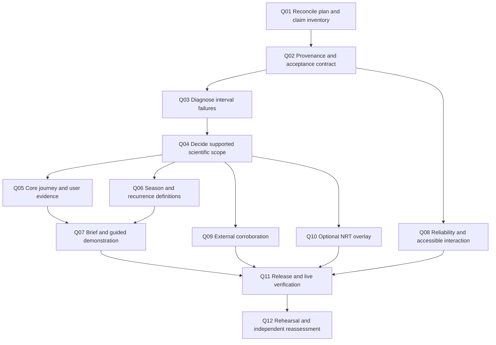

# FireSense: roadmap toward a defensible 9/10 submission

**Execution scaffold installed:** use [hardening-scaffold.md](hardening-scaffold.md) and the current plan cards/board for actual work order, scopes and run specifications. Q01-Q12 below remain rationale labels; T51-T63 and reconciled existing cards implement them. The scaffold's explicit deferred scope and scientific protocol supersede provisional sequencing here.

Planning baseline: **6 November 2026, source `e97d49f`**. This is a proposal responding to the [dated assessment](review-2026-11-06.md), not a new evaluation score or completed implementation. Read the [architecture](architecture.md) and [scientific walkthrough](../science/harmonization-walkthrough.md) alongside it.

**Authorization update, 6 November:** Sheikh explicitly authorized agent-operated training and replaced the former no-training rule and H03 freeze. This revision makes Q04 scientific remediation an executable path. See [the authorization record](training-authorization.md). Historical measurements and the assessment score have not changed merely because execution is now permitted.

## 1. Outcome and boundaries

The goal is a scientifically candid, usable and well-demonstrated **regional historical burning-activity explorer**. A planner should be able to identify the central activity window, compare seasons and locations, explain the sensor provenance, and export a useful brief without mistaking detections for burned area or historical status for a forecast.

A 9/10 score is an aspiration under this review's rubric. It cannot be guaranteed by implementing a backlog, and it is not an official NASA score or a prediction of an award. Stronger scientific evidence and real user observations must change the assessment.

Constraints retained:

- Agent-operated training, ratio fitting, recalibration, fitting tests, readiness probes, pipeline stages and integrated QA are now authorized. Follow [AGENTS.md](../../AGENTS.md): declare runs, preserve baselines and record provenance/evaluation honestly.
- H02/H03 remain historical completed runs. Their former training freeze is superseded; new numerical validation uses new scientific-run cards/specs rather than relabeling old results.
- Routine card checks remain non-fitting. Scientific execution is a separate documented lane; legacy `human_checks` labels no longer reserve those commands for Sheikh.
- Keep the English, named-area, single-origin Render architecture. Retired snapshot/Pages/Bangla delivery is not restored through old card instructions.
- No new dependencies, cloud services, paid hosting or geography expansion are assumed. No automatic contact with users, experts or organizers is authorized by this plan.
- Scientific changes need a spec, contract implications and Sheikh's sign-off through the repository workflow. No tuning acceptance thresholds to obtain a desired verdict.

The prior documentation is still uncommitted. Before implementation, Sheikh should review/commit that work and this roadmap so each implementation card starts from an attributable baseline. Planning can proceed without modifying those files or the plan board.

## 2. What would justify a higher rating?

Current scores below are judgments from the dated review. The target column describes evidence to seek, not points already earned. All five rubric dimensions would need to be strong to justify an overall 9.

| Dimension | Current | Target evidence for approximately 9 |
|---|---:|---|
| Impact | 6 | Intended users independently complete a useful planning task; a practitioner confirms the result is relevant and identifies its limits; an exported brief supports a concrete workflow |
| Creativity | 7 | One distinctive, defensible contribution is demonstrated end to end: instrument/source-aware historical comparison and uncertainty-aware interpretation; a recurrence map or carefully qualified observation-time analysis adds a clear user benefit |
| Validity | 5 | Claims match artifact provenance and served targets; relevant held-out results and conditional failures are disclosed; unsupported bands/forecasts cannot masquerade as accepted results; an external check is interpreted with its dependence and limitations |
| Relevance | 9 | A complete area-to-calendar-to-comparison-to-export journey directly answers the verified MODIS/VIIRS brief, with regional scope explicit |
| Presentation | 6 | A clear, timed demonstration, accessible interaction and readable evidence pages work on phone and desktop; the presenter can answer scientific questions without overstating results |

Engineering's path from 8 toward 9 is release provenance, measured resource/interaction behavior, reliable degraded states and a tested handover. It does not require a database or microservices.

**No automatic score arithmetic:** removing an unsupported claim improves honesty, but does not by itself provide the evidence needed for scientific readiness of 9. A polished prototype can remain below the overall target if central scientific or impact gates stay unresolved.

## 3. Priority and scope decisions

| Priority | Work | Why now |
|---|---|---|
| P0 | Reconcile the plan, freeze the claims, establish artifact provenance and expose scientific acceptance | Prevent new work from amplifying stale or unsupported evidence |
| P0 | Diagnose conditional intervals using existing evidence; register a science acceptance decision | The largest validity deduction is unresolved |
| P1 | Verify the core journey and accessibility; observe intended users; produce an evidence-bearing brief | Turn a functioning codebase into a demonstrated useful product |
| P1 | Finish a small, coherent season/recurrence experience after its science definitions are corrected | Improve the calendar task and a defensible differentiator |
| P1 | Package and verify a reproducible live release; rehearse the scientific story | Make judging-time behavior and claims reviewable |
| P2 | Corroborating burned-area analysis and an observation-time exploratory note | Useful only with correct design and available data/time |
| P2 | Optional NRT season overlay | Adds operational complexity and does not repair historical calibration |
| Defer | Extra learners, forecast alerts, global expansion, restored translations, uncalibrated FRP view | Does not resolve the main evidence and usability gaps before freeze |

Deferral here is a recommendation. No existing card is silently cut or bypassed. Amend card dependencies and status through the normal workflow before changing execution order.

## 4. Execution sequence and dependencies

Q01-Q12 are proposal labels in this document, **not installed plan card IDs**. Q09 and Q10 have explicit defer branches; they must not block the core release when deferred and disclosed. Several workstreams can be designed independently, but the working tree/card flow remains sequential unless Sheikh changes it.

The plan currently returns **T14**. Before executing it, resolve the scope/spec conflicts below. This roadmap does not mark it complete or claim the scheduler has been reordered.

## 5. Q01 — Reconcile the existing plan and define the claim inventory

**Effort estimate:** 2-4 focused hours. **Execution:** agent prepares amendments; Sheikh reviews/commits. Estimates throughout are planning ranges, not observed durations or guaranteed capacity.

Read all affected cards and current implementation before amending their paths/checks. Keep the ownership rules. Update only evidence-backed status notes; retain the historical record.

| Existing card(s) | Proposed amendment |
|---|---|
| T17 / T49 | Replace the stale deployment-blocker description with the dated successful observation and remaining science dispositions; a live check is time-specific, not permanent acceptance |
| T13 / T46 / T47 | Keep interval reporting distinct from interval remediation; preserve failure visibility and require target/provenance fields in new releases |
| T14 / T15 | Resolve season confidence semantics, false-flag expectations, missingness and adjusted-versus-observed distinctions before implementing flags |
| T18 / T19 | Use the live architecture and catalog exporter; remove retired snapshot references; add pinned/live boundary and missing-coverage acceptance |
| T20 | Reframe detection-time statistics as exploratory; do not infer orbital motion or unseen burning from detections alone |
| T21 / T22 / T23 | Remove snapshot/Bangla prerequisites; use tiny fixtures and live API; derive year labels from actual eligible seasons; avoid saying a detection proves a cell burned |
| T24 / T33 | Describe MCD64A1 as a corroborating product, not independent ground truth; verify QA/product metadata and dependency limits |
| T27 / T34 | Test the current English live UI; remove obsolete snapshot budgets and unused-language requirements; include actual manual keyboard/assistive checks |
| T28 | Separate engineering readiness from scientific acceptance; incorporate the newly authorized scientific runs and distinguish source/artifact revisions |
| T29 / T35 | Use accepted runtime evidence, qualify uncertainty and findings, remove assumed translation capabilities, and verify submission format limits before asset production |

Create a small claim inventory: claim, audience, source artifact, source revision/run, served endpoint/UI, validation status, allowed wording and prohibited interpretation. Include detection counts, sensor seams, interval nominal level, seasonal trends, cropland associations, forecast disposition and data freshness.

**Acceptance:** plan validator passes; no pending card instructs retired delivery, a superseded training ban or unexpected fitting in routine checks; the board agrees with dated evidence; every headline claim has a provenance row. Do not loosen scientific assertions merely to resolve a conflicting card.

## 6. Q02 — Make provenance and scientific acceptance machine-readable

**Effort estimate:** 4-8 hours. **Existing anchors:** T47/T49/T28. **Likely scope for a new/amended card:** runtime packaging/release scripts and tests, deployment manifest, validation schema/producer, API metadata and validation presentation. Exact paths must be declared in that card before implementation.

### Design

Add a small release evidence manifest, with a versioned contract, containing:

- The serving source commit and artifact producer commits/runs separately. A UI-only release may legitimately serve older artifacts; require explicit compatibility rather than pretending every commit trained the record.
- Data source/product version, retained geography, record end and build/release time.
- Selected method, parameter hash, OOF hash/split definition, sensor-day hash, interval-table hash and report hash.
- Weekly and monthly target definitions, calibration/evaluation sampler versions, data filters and method/spec version.
- Forecast validation status, scientific interval status and missing evidence notices.
- An immutable runtime release identifier and archive checksum. The manifest cannot contain a hash of the archive that contains itself; retain the outer archive checksum in `deployment/runtime.json` and internal member hashes in the evidence manifest.

Define three states with separate meanings:

1. **Engineering ready:** contracts, required files, checksums and serving paths pass.
2. **Scientific evidence:** accepted for a named scope, limitation/stop condition, or missing/stale/incompatible.
3. **Delivery verified:** the observed live commit, runtime identifier, dates and served evidence match the intended release.

New production releases must not display a general accepted/calibrated badge when evidence is missing, incompatible or contains stop rows. Permit a deliberately limited research-demo release only with an explicit release disposition, visible limitations and the same evidence attached. This must not be an unrestricted boolean bypass. Legacy archives can remain readable with an `unknown_legacy`/equivalent status; never upgrade their scientific status by default.

The release verifier should recompute critical status from report rows and compare it to declared status, validate finite metrics/schema, and reject mismatched targets/hashes. Do not trust only a saved `acceptance_status` string or five passing engineering groups.

### Tests and evidence

Use handcrafted JSON and tiny fixture artifacts: missing report, stale hash, legacy target, positive stop row, corrupt/nonfinite metric, accepted scoped report and explicitly limited demo. Test API/UI semantics as well as packaging. Nothing needs a fit.

**Acceptance:** a reviewer can trace one live chart to its saved inputs and scientific disposition; a fabricated green engineering QA file cannot turn failing interval evidence into accepted science; unsupported scope remains visibly limited in Method, Validation, charts, exports and story content.

## 7. Q03 — Diagnose interval failures before changing the method

**Effort estimate:** 6-12 hours for diagnosis/spec, excluding compute runtime. **Existing anchors:** T13/T46 and current `conformal.py`, `interval_report.py`, `common/series.py`.

Current saved positive-activity coverage is approximately 0.733/0.471 weekly for Terra+Aqua/Terra-only. Those are historical observations from the dated review, not the latest target's results. The monthly report lacks the new calendar-month target label. These problems must be investigated separately.

### A. Freeze and inventory

Read and hash existing OOF, grid, sensor days, interval table and reports. Preserve them. Record splits, target, selected method, product cutoff and known changes. Record which test results have already been inspected: those outcomes cannot become an untouched final test by renaming a split.

### B. Diagnose on saved evidence

Begin with reviewed diagnostics on saved predictions, writing a separate report and preserving calibrated artifacts. Agents may execute pipeline diagnostics under the current scientific-run policy. Fitting a repair belongs to Q04 after the diagnosis and acceptance criteria are recorded.

Break down failures by:

- input combination, resolution, season and land cover;
- positive truth versus zero truth, and positive truth with zero prediction;
- predicted magnitude and truth magnitude, clearly separated;
- unique contributing cells, drawn rectangle size, block/year and available-days completeness;
- sensor source/adjustment and extrapolation beyond sampled calibration sizes;
- below-lower versus above-upper misses, interval width and interval score.

Check target consistency: the same held-out weekly predictions, MODIS-based day allocation and SNPP daily truth must produce matching calendar-month sums. Cover month/year boundaries, leap years, missing weeks and Terra-only input. Do not call a calendar correction a calibration success until it is measured.

Inspect training/calibration/test separation and overlap between sampled rectangles. A large count of overlapping draws is not an equivalent number of independent observations. Report unique spatial/temporal units; use a justified block-aware uncertainty analysis if one is run. Do not create narrow binomial confidence intervals from correlated draws.

### C. Test the applicability domain

The sampler's rectangles are contained in holdout blocks of up to 400 nominal grid cells. Named administrative AOIs can be larger or differently shaped. Audit actual query sizes, connectedness and source mixtures. Either evaluate the supported deployment shapes/resolutions honestly or limit the claim and display unsupported-scope status. Never add independently calibrated rectangle intervals together to manufacture AOI coverage.

### D. Produce a decision memo

Rank plausible causes by evidence: target mismatch, zero-inflation, calibration mixture imbalance, combination fallback, region/season shift, sparse support or inconsistent availability. Show examples and counterexamples. A cause is a hypothesis until the audit supports it.

**Acceptance:** each large failure has a traceable diagnostic, target identity is explicit, accepted and unsupported AOI domains are named, and the next scientific decision follows the evidence. A report that merely repeats marginal coverage does not close Q03.

## 8. Q04 — Repair and validate the scientific procedure

**Effort estimate:** 2-4 hours for the initial decision/spec; initial implementation approximately 4-8 hours, plus measured compute and evidence-driven iterations. **Agent role:** develop the scientific spec, implement, train/recalibrate, evaluate and report. Sheikh retains the established final commit/review flow.

### Route A: preserved artifacts and a bounded historical product — fallback

Preserve existing fitted artifacts as the comparison baseline. Agents may recompute compatible diagnostics and integrated QA with their execution effects reviewed. A bounded historical product remains a fallback if the remediation cannot meet acceptance criteria; failure visibility is required during experimentation as well.

If conditional failures persist:

- Retain their report and source/era caveats. Mark bands as unaccepted for the affected scope; select a scientifically reviewed chart policy (for example, an optional sensitivity display with an adjacent warning rather than a default accepted-band appearance).
- Keep observed, NOAA-20 adjusted and MODIS modeled values distinct. Missing uncertainty is not a zero-width reliable interval.
- Any categorical conclusion that relies on a failing modeled band must be qualified or withheld. Trace this through current-status levels, season flags, trends, briefs and story mode.
- Keep forecasting unvalidated and alerts off. Current-status percentiles remain historical comparisons, not future risk probabilities.
- Refresh only evidence that was actually recomputed and evaluated; otherwise retain its historical revision label.

This fallback can improve the submission's engineering, relevance and credibility. It does **not** assure scientific readiness or overall readiness of 9. If the central scientific claim remains unresolved, record the lower score honestly.

### Route B: agent-operated scientific remediation — now authorized

Prepare explicit scientific cards for the procedure changes and attributable runs. Agent-operated model fitting, residual-scale fitting, ratio adjustment, calibration and full numerical validation are authorized by Sheikh's policy update. Start after Q03 and the registered evaluation design; do not launch an unplanned fit merely to exercise the permission.

Execute an initial controlled cycle: preserve/hash the baseline; inspect readiness/setup paths and available resources; run the smallest useful implementation/fit checks; run all required holdouts on a candidate; generate calendar-aligned diagnostics and integrated QA; compare point estimates, coverage, width and score; then retain, revise or reject the candidate. Record failures and resource costs. Quick-run evidence does not replace the full comparison.

Use fresh run directories or the runner's verified baseline backups. Run one pipeline per output tree and keep the live service on its pinned accepted/limited runtime while experiments proceed. Promote a candidate only when its scoped acceptance criteria pass; permission to train is not permission to publish a failed scientific result as accepted.

Candidate directions, to consider only after Q03: prediction-based activity/magnitude strata; explicit Terra-only versus Terra+Aqua handling; sparse-stratum fallback with support labels; count-sensitive scores that can accommodate positive truth at zero prediction; dependence-aware sampling and deployment-shaped AOI evaluation. Prefer the simplest supported method; no additional learner is required by this plan.

Register the choice and criteria **before** testing it. Do not calibrate on `y > 0` from a future outcome and assume that group is known at prediction time. Truth-conditioned positive groups are valuable diagnostics; a deployed grouping rule must use information available for that prediction. Do not widen bands on the inspected test set until a green result appears.

Keep fit/calibration/selection/confirmation roles separate. If old test outcomes informed remediation, call the old results development evidence. Any fresh confirmation must have a defensible uninspected spatial/temporal design; if none is available with the existing data, report that limit. Additional training does not manufacture independent observations.

### Proposed scientific quality gate

These are **proposed review criteria**, to register in the spec, not current results or NASA requirements:

| Gate | Criterion |
|---|---|
| Target/provenance | Exact served target, source combination and compatible artifact hashes documented |
| Existing severe-failure rule | Preserve every `n >= 500` and coverage `< 0.80` stop condition; missing/undersupported strata are not successes |
| Nominal goal | Report the 0.90 target with empirical coverage and dependence-aware uncertainty, including positive activity; do not relabel 0.80 as calibrated 0.90 |
| Primary group review | Register relevant groups and a tolerable coverage gap before new evaluation; a proposed starting tolerance is 5 percentage points, not a universal conditional guarantee |
| Usefulness | Publish width and interval score alongside coverage and compare against the frozen baseline on the same eligible samples; require a justified width/skill tradeoff rather than unbounded bands |
| Support | Publish sample counts, unique blocks/periods, fallback frequency and applicability limits; unsupported queries receive an explicit limitation |
| Selection honesty | All attempted methods disclosed; no inspected development score called untouched confirmation |

Universal exact finite-sample conditional coverage is not generally available. Restricted-group guarantees need stated assumptions and a matching procedure; see [Gibbs, Cherian and Candes](https://arxiv.org/abs/2305.12616). This roadmap does not claim the current sampler meets those assumptions.

**Acceptance:** an attributable numerical comparison and scientific disposition exist, consumers enforce them, and the rating reflects the route actually completed. All required holdouts and the detailed interval target/provenance are reported; failed candidates remain failures. The acceptable outcome of a diagnostic is sometimes a narrowed claim.

## 9. Q05 — Establish usefulness with intended users

**Effort estimate:** 4-6 hours preparation/analysis plus participant availability. **Existing gap:** no card currently provides direct intended-user evidence; propose a small new card. **Human role:** Sheikh recruits/contacts participants and obtains consent. The agent prepares materials and implements authorized fixes; it does not message anyone.

Choose one primary audience first: an environmental analyst, local planner, agricultural extension worker or relevant NGO practitioner. Avoid trying to validate emergency response usefulness with only developer friends.

### Session design

Recruit 3-5 formative participants if feasible, including at least two with relevant planning/data responsibilities. This is qualitative evidence, not a population study or an impact trial. If only proxies are available, label them and retain the impact limitation.

Give neutral tasks, without revealing the desired answer:

1. Find the central activity window for a named region and explain what it measures.
2. Compare two complete seasons at the same relevant cutoff; identify the sources and a limitation.
3. Explain whether a quiet week means no fire, missing observations or activity outside the observation system.
4. Export a brief and tell a colleague what decision it can support and what it cannot establish.

Record completion, time, help required, errors, source/date comprehension and a short explanation in the participant's words. Preserve anonymized notes with consent; store identifying information outside Git.

Suggested formative targets: at least 4 of 5 participants complete the core journey with no more than one prompt; all can distinguish modeled versus observed and detections versus burned area after reading the relevant labels; no participant leaves believing this is a validated warning service. For fewer participants, report the raw counts rather than pretending the percentage is statistically stable.

Fix high-severity confusion, then repeat the tasks with a fresh participant where possible. Ask an experienced practitioner to review one final brief and identify a plausible action, not endorse unsupported science.

**Acceptance:** observed evidence and failures are documented; one concrete workflow is improved; no fabricated adoption, avoided losses or impact percentages appear in the submission. A polished user persona alone earns no impact evidence.

## 10. Q06 — Finish season and recurrence features with defensible semantics

**Effort estimate:** 8-14 hours after spec decisions. **Existing cards:** T14/T15/T21. These are implementation estimates, excluding review/commit delays.

### Season flags

Amend T14 before implementation:

- Preserve same-cutoff comparison for partial seasons, recent-ten and all-history reference bases, minimum history, zero/missing distinctions and coverage exclusions.
- Do not equate low `modeled_share` with fully observed SNPP: adjusted NOAA-20 also needs explicit provenance.
- Summed weekly lower/upper bounds are sensitivity scenarios, not a calibrated season interval. Use a label such as `stable_under_sensitivity` rather than an unqualified `confident` field, or otherwise make its limited semantics unavoidable. Do not add scenario bounds as though they had calibrated joint coverage.
- A 10th/90th-percentile rule flags approximately 20% of values under an ideal matching continuous distribution. The existing test allowing at most 3 flags in 24 noise seasons is not a general statistical guarantee. Agree on the intended false-flag behavior and deterministic edge-case tests; do not tune a random seed to pass it or silently weaken an existing check. Any changed acceptance requires an explicit spec decision.
- Keep incomplete, low-activity and insufficient-history states separate. Avoid an unusual/normal verdict where prerequisites fail.

Use pure fixtures for season boundaries, adjusted-only data, missing coverage, tied values, same-cutoff comparisons, reference exclusion and sensitivity disagreement. Include schema/API/UI propagation.

### Recurrence

Use observed-SNPP rows only and a coverage-qualified denominator. Include zero-detection cells in eligible seasons; an absent sparse detection row is zero only with adequate observation. Derive the year range and eligible `n_years` from data; no fixed `2012-2025` legend.

Label it **share of eligible seasons with at least one detected hotspot**, not a probability of fire or proof that each cell burned. Show observation limits and low-support cells. Verify cross-year seasons, fully quiet cells, outages, adjusted/model exclusion and per-AOI geometry consistency.

Add a single layer toggle with a comprehensible legend. The default calendar should remain usable without discovering a new mode.

**Acceptance:** a user can explain both features accurately; every result has a denominator/reference basis; no new scientific assertion bypasses Q04. If the feature adds confusion or threatens freeze, defer it and keep the existing complete journey.

## 11. Q07 — Turn the core journey into a brief and a compelling demonstration

**Effort estimate:** 8-12 hours. **Existing cards:** T22/T23/T29/T35. Start script/storyboarding early; final numbers and screenshots wait for release evidence.

Create an English A4 brief from the actual selected area, season and runtime data. Include central activity window, source fractions, data-through date, same-cutoff seasonal status, qualified spatial information, method/runtime identifiers, share link and a concise limitations box. If recurrence is deferred, use an honestly labelled existing spatial view or omit it through an approved card amendment.

The brief must still make sense outside the app. Print to one page without map-tile dependencies, clipped labels or hidden caveats. Verify the longest area name, a missing-data case and a low-support case. Unsupported trends are omitted or explicitly described as uncertain.

Use one narrative:

1. Different instruments create a misleading seam in a simple count history.
2. FireSense uses a stated reference scale and explicit observation provenance.
3. One regional calendar answers a real seasonal planning question.
4. A Bangladesh/Punjab comparison shows why local context matters.
5. Validation shows both what held up and where uncertainty remains weak.
6. The user leaves with a brief and a clear next action.

Do not force a story about later burning, lower emissions or fewer actual fires. If exploratory results are inconclusive, that is the result. Every numerical statement is read from the supported runtime or linked to an explicitly historical run.

Aim for a 90-second guided product journey and a 3-minute spoken demonstration, then adapt to verified submission limits. The existing 7-slide/30-second asset assumptions are internal targets until current submission guidance is confirmed. Final asset production and rendering follow their relevant document/presentation skills when that work is requested.

Prepare answers to: Why SNPP? Why B1? What is modeled before 2012? Why not sum the sensors? What do clouds/outages do? Are the bands accepted? Does a declining detection trend mean less burning? What is global versus regional? What remains unvalidated?

**Acceptance:** the story works with current evidence, exits cleanly, supports keyboard use/reduced motion, and is timed in the actual interface. A recording supports contingency presentation; it is not described as an offline application mode.

## 12. Q08 — Measure reliability, interaction and accessibility

**Effort estimate:** 8-12 hours, plus fixes proportional to findings. **Existing cards:** T27/T34 plus a bounded runtime-measurement amendment.

### Core interaction matrix

Test supported regions and no-data/unsupported selections; day/week/month changes; leap/month boundaries and ISO week 53; rapid area/date/view switching; comparison cancellation; share-link reload; download failures; metadata timeout; missing/corrupt validation pieces; cold service startup and network loss. Verify no stale response overwrites a newer selection and no failure turns missing values into zeros.

### Device and accessible use

Observe the live production UI at 360, 390, 768 and 1366 px, and on a real phone if available. Record browser/OS, viewport and evidence. Require no horizontal page overflow, readable labels, operable dialogs and correct focus after navigation.

Check the entire task by keyboard, visible focus, meaningful labels, error announcements, map-independent area selection, chart/calendar text alternatives, source distinction beyond color and reduced motion. Use [WCAG 2.2 guidance](https://www.w3.org/WAI/WCAG22/quickref/) as the reference. An automated accessibility score is supplemental; it is not a conformance certificate. A CSS-outline inspection alone does not establish keyboard accessibility.

Existing internal targets of Lighthouse accessibility >=90 and mobile performance >=80 may be retained, with actual audit conditions recorded. No result is claimed if the tool cannot run. Use current installed/approved tooling; old pinned tool commands in cards need review, and new dependencies need Sheikh's approval.

### Runtime measurements

Measure supported small/large AOIs across summary, season, cells and comparison; record response size, warm/cold latency, process memory and cache behavior. The earlier 2.6-second sample is one request, not a benchmark.

Suggested initial engineering budgets, to register before measuring: warm summary p95 <=3 seconds over at least 20 representative requests; no unhandled errors in that bounded sample; memory remains within the actual configured service limit with headroom and no unbounded growth after repeated area changes; visible loading/error feedback during cold start. These are proposed project budgets, not current measurements or hosting guarantees. Document request mix/cache state and avoid production stress tests; exercise concurrency locally first.

Audit 256-entry response and 64-entry Store memo caches for payload size. Add a byte budget or safer endpoint-specific bounds only if measurements justify it. Re-measure after a performance change; do not migrate storage infrastructure speculatively.

**Acceptance:** all critical user tasks pass; no unresolved high-severity scientific/source confusion or accessibility blocker; benchmark conditions and capacity limits are explicit; every material defect has a reproduction and disposition.

## 13. Q09 — Obtain corroborating evidence without overstating independence

**Effort estimate:** 6-12 hours if data is available; downloads/review availability are additional. **Existing cards:** T33/T24; T20 is an optional exploratory companion.

MCD64A1 uses reflectance **and MODIS active-fire inputs**, so it is not independent of the MODIS information in this project. The [algorithm paper](https://pmc.ncbi.nlm.nih.gov/articles/PMC6136150/) documents that dependency. Amend the card title/wording to distinguish corroboration from independent reference evidence.

For a burned-area comparison: verify product collection, QA bits, fill/water/unmapped values, actual grid metadata, pixel area, date uncertainty, cross-year season assignment and cell/AOI boundaries. Do not rely on a generic negative-value rule or a copied constant without checking the product guide. Separate valid zero burned area from unmapped observations.

Predeclare included years/areas, common eligibility and endpoints such as seasonal ordering, rank association and p50 timing differences. Report every included year, missingness and disagreement. Do not optimize geographic/year selection or offsets to obtain a positive result. Detection totals remain different units from burned area; a correlation does not validate absolute counts or causal interpretation.

If feasible, request a practitioner/expert review or use a small, transparently selected set of higher-resolution published reference observations. Describe whether that evidence is actually independent, and avoid generalizing a few examples to regional accuracy. Do not add a classifier or fit a new model for this check.

For T20, detection-conditioned local-time distributions do not reveal the timing of fires that were never detected. A shift in detected times also confounds opportunity, clouds, orbit/sampling and fire behavior. Orbital drift claims need independent observation-opportunity/orbit metadata, not medians of detected fires alone. Synthetic tests must model both fire occurrence and observation opportunity; code that reproduces a planted signal does not establish identifiability in real data.

**Acceptance:** an honest corroboration/limitation report or a clearly documented deferral. No favorable verdict is required, and no exploratory association becomes a proof of unseen burning.

## 14. Q10 — Treat NRT as an optional, separately bounded product

**Effort estimate:** 10-16 hours, plus host/data availability. **Existing cards:** T18/T19. Do only after the core evidence, user journey and release gates are stable.

Keep the immutable historical record and the NRT overlay separate. Reuse saved adjustment parameters without fitting. Export only required derived values to the backend; never ship model pickle files or credentials to the browser.

Before implementation, specify:

- The exact pinned/live boundary, UTC acquisition versus local-date handling and duplicate policy across that boundary.
- Which source/product and confidence filters are used; whether standard and NRT counts are comparable; the saved adjustment's applicability.
- Coverage semantics: empty NRT data is not proof of no fire or a complete season; a missed/unknown gap blocks a complete season-to-date percentile.
- Cross-year season indexing and full window lengths rather than a universal 120-day cumulative array.
- TTL, timeout, bounded retries, cache concurrency, last-good behavior, rate limits and off/failed/stale/suspect states. Without a key the historical app still works.
- Safe status text. A five-times-historical-maximum rule is a heuristic data-quality flag, not evidence that a genuine extreme fire day is false.

Use mocked network tests for redaction, time boundaries, de-duplication, late revisions, empty/gapped feeds, partial weeks, outages, repeated requests and missing ratios. Verify one explicitly authorized live fetch without exposing the key. This is a current-activity overlay, never a validated forecast or automatic refresh of historical calibration.

**Acceptance:** no contamination/double counting of pinned artifacts, freshness and unknown coverage are visible, failures preserve the historical journey, and the live result is verified on the deployed service. If this cannot be demonstrated before freeze, defer it explicitly.

## 15. Q11 — Release a verifiable package

**Effort estimate:** 4-6 hours excluding builds/host waits. **Existing anchors:** T16/T17/T28/T49. **Commit/push/tag:** Sheikh unless explicitly authorized otherwise.

The release dossier contains: source revision, runtime release identifier/checksum, member hashes/targets, claim inventory, engineering checks, scientific dispositions, unresolved limitations, user-session notes, device report and demo assets. Keep participant identities, secrets and generated large artifacts outside Git.

Run relevant reviewed non-fitting regressions, frontend checks, syntax, OpenAPI and plan validation in the routine lane. Full Python suites, smoke, fitting tests and integrated QA are now authorized in the scientific-validation lane after execution-path review and output preservation. The routine guard remains intact; do not disguise scientific commands as routine checks. Fresh test counts belong to that exact release; old counts remain historical.

Package existing authorized artifacts into a **new** immutable runtime release. Never overwrite a released asset. Confirm archive contents, target/provenance compatibility and declared limited-demo disposition before publication. Keep a previous compatible code/runtime pair for rollback.

After Sheikh pushes the intended commit:

1. Run `python scripts/check_render.py --commit <intended-commit>` with the configured URL handled without logging credentials.
2. Inspect served validation contents, acceptance status, target, runtime identity and critical hashes, not just piece presence.
3. Complete the supported user journey on the actual deployed app and record its date/browser.
4. Tag only the verified final commit when Sheikh declares it final. A successful push or build is not a live revision observation.
5. Prepare a local live build with the existing runtime and a recorded demo as contingencies; rehearse without internet. Do not advertise a retired static fallback.

**Acceptance:** source and artifact identities are verified live, claims match the release dossier, rollback/contingency paths are understood, and no critical unresolved bug is hidden by a green build.

## 16. Q12 — Rehearse, challenge the claims and re-rate

**Effort estimate:** 3-5 hours plus reviewer availability. **Existing cards:** T29/T35 and human submission steps.

Have someone unfamiliar with the implementation watch the demonstration and ask the scientific questions in Q07. Prefer a practitioner for usefulness and a technical reviewer for provenance/validation. Reviewers need not endorse the project; disagreements become evidence to address.

Score each dimension again using the original anchors, attaching the new evidence and remaining caveats. A person who contributed code should disclose that role. Do not assign a higher score merely because this roadmap is finished.

**Acceptance:** an updated dated assessment explains changes in scores; all five dimensions have supporting evidence; unpassed scientific or impact gates remain explicit. The result may honestly be 7 or 8 rather than 9. That is preferable to an unsupported rating.

## 17. Capacity, milestones and cut order

The original planning estimates summed to approximately **55-100 focused hours** for the core packages, plus **16-28 hours** for optional external analysis/NRT. Those estimates predated permission to run numerical remediation and are not a complete estimate for the expanded scientific cycle. Add actual readiness, fitting, report-generation and iteration costs after the first controlled run; no fixed number of fits or guaranteed completion date is asserted. Some investigation can serve multiple packages, but integration/rework and data/participant/host waits can offset that saving.

For a smaller release, defer Q06's new features, keep the existing map/calendar/comparison/CSV journey, produce a simple evidence-bearing brief and rehearse the existing interface instead of building guided-story UI. Preserve Q01-Q05's scientific/claim decisions, critical Q08 interaction checks, Q11 verification and Q12 reassessment. This reduces implementation scope; it does not waive the evidence gates or guarantee a 9. With one person working an assumed six focused hours per day, six days provide only about 36 hours: the full proposal would need substantially more time or actual human capacity, not merely a more optimistic schedule.

The existing plan uses 12 November 20:00 Dhaka as its freeze. Treat the schedule below as an internal capacity plan, not a verification of event/submission dates. Advance only when gates pass; never compress science by relabeling old evidence.

| Internal window | Primary outcome | Gate |
|---|---|---|
| 6-7 Nov | Q01 plan amendments, claim inventory, provenance design and interval diagnostic memo | Know what can be claimed and which evidence remains unavailable |
| 8-9 Nov | Limited-scope science handling, first user sessions and core interaction fixes | A useful journey with honest source/uncertainty interpretation |
| 9-10 Nov | Minimal season/recurrence/brief work that survived prioritization; start rehearsal | One coherent demonstrated workflow; optional work only if capacity exists |
| 11 Nov | Device/accessibility checks, second user pass, final narrative and measured runtime behavior | No critical usability/claim blocker |
| 12 Nov before freeze | New compatible runtime if required, code release, live verification and final dossier | Reproducible serving revision and truthful claims |
| Before submission | Rehearsal, asset/rule-format verification and independent reassessment | Evidence supports the final submission wording |

If the first two days reveal unresolved central validity or capacity problems, **do not add optional features**. Complete the bounded historical product, usability evidence, brief and verified release first.

Recommended cut order: uncalibrated FRP view; NRT overlay; speculative blind-spot analysis; additional geography; animated story UI in favor of a rehearsed existing-interface demo; recurrence if it jeopardizes core task completion. Keep the claim inventory, provenance, scientific disclosure, core accessibility, user task, export and verified release. Any actual cuts require corresponding plan amendments.

## 18. Final score gate checklist

| Evidence | Required disposition before claiming the target |
|---|---|
| Scientific scope and target | Explicit, compatible with artifacts and not contradicted by the pitch |
| Conditional uncertainty | Accepted for the claimed scope with evidence, or clearly limited; a central unresolved failure prevents scientific readiness of 9 |
| Pre-2012 reconstruction | Modeled provenance and extrapolation limits visible |
| Seasonal/status conclusions | Coverage-qualified, same-cutoff, source-aware and not advertised as forecast skill |
| Usefulness | Real observed tasks and practitioner feedback; proxy evidence disclosed |
| Distinctive contribution | One implemented and intelligible contribution, not a speculative claim |
| Interface | Actual phone/desktop and keyboard task evidence; no critical source/date confusion |
| Reproducibility | Live source/runtime/report identity traced to the release dossier |
| Presentation | Timed, clear, sourced and adapted to confirmed submission format |
| Reassessment | Independent scrutiny and a dated rating justified by evidence, with no promised award outcome |

## 19. Immediate next planning actions

1. Review/commit the documentation baseline and this proposal through Sheikh's normal flow.
2. Install Q01's narrowly scoped plan amendments first; do not begin the old T14 implementation unchanged.
3. Establish the provenance/acceptance contract and produce the interval diagnostic decision memo.
4. Register the scientific-remediation design and execute attributable training/calibration/evaluation cycles; retain the bounded historical-product fallback if results do not meet acceptance.
5. Start user-session preparation while agent-safe engineering work proceeds; contact/recruitment remains Sheikh's step.

No training, application changes, release publication, participant outreach, plan-board changes or additional test execution was performed in preparing this roadmap. The earlier dated verification remains historical evidence at its stated source revision.
